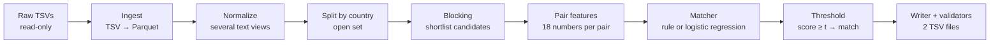

# How our entity-resolution system works (implemented system, Phase 2)

This document explains **what the code actually does today**, in plain language. It does not cover future ideas.

- **Why** decisions were made: [DECISION_LOG.md](DECISION_LOG.md).
- **What was measured**: [EXPERIMENT_LOG.md](EXPERIMENT_LOG.md).
- **How to run it**: [../README.md](../README.md).

There are two systems in the repo:

| System | Config | Status |
|---|---|---|
| **Submission 1** (EXP-B-01) | `configs/baseline_v0.yaml` | Blocking v0 + **hand-weighted rule** (not trained). Public LB 0.751, validation 0.7851 |
| **Current best** (EXP-F-01b) | `configs/exp_f01b_conflicts_zeros.yaml` | Blocking v1 + 18 features + **logistic regression (trained)**. Validation 0.8371 at dev scale (precision 0.9316); full-scale run pending |

---

## 1. The whole system in 9 steps

1. **Ingest.** Read the organizers' TSV files once, check the row counts, and save typed Parquet copies. Raw files are never modified.
2. **Normalize.** For every record, build several cleaned versions of the name and address ("views").
3. **Split by country.** Process each country separately, using whatever country labels exist (France included).
4. **Blocking.** For every Source-1 business, retrieve a short list (at most 20) of plausible Source-2/3 records.
5. **Pair features.** For every (S1, candidate) pair, compute similarity numbers: name similarity, address similarity, number overlap, conflicts.
6. **Matcher.** Turn the features into one score between 0 and 1.
7. **Threshold.** Keep a candidate as a match if its score ≥ the threshold.
8. **Writer.** Write `candidate_pairs.tsv` (the exact shortlist that was scored) and `matching_results.tsv` (the kept matches). There is exactly one row per test S1, UTF-8 without BOM and LF line endings.
9. **Validation.** Run our strict validator and the official validator.

---

## 2. Component by component

### 2.1 Ingest (`src/ber/data/ingest.py`)

- **Problem:** The raw TSVs are large (up to 500 MB each). A few rows use `""` quote escapes, and the files use Windows line endings.
- **How it works:** pyarrow streams each file in 16 MB blocks and writes Parquet. The parsed row count must equal the file's line count, or the run stops.
- **In:** `datasets/{train,test}/*.tsv`. **Out:** `data/interim/{split}/*.parquet`.
- **Why:** Parquet is compact and columnar, so later steps read only the columns they need. That matters with ~2–3 GB of free RAM.
- **Trained?** No.

### 2.2 Normalization (`src/ber/normalization/`, `src/ber/data/normalize_records.py`)

- **Problem:** The same business is written in many ways:
  - case: `ACME LTD` / `Acme Limited`;
  - accents: `Àmicale`;
  - punctuation: `M/s.`;
  - Indian scripts: `राज`;
  - address abbreviations: `Rd` / `Road`.
- **How it works:** It builds several **views** instead of one "cleaned" string (DEC-003):

| View | Example (`M/s. -- APAR (Limited)`) | Used for |
|---|---|---|
| `name_norm` | `m s apar limited` | exact-name block, name features |
| `name_core` (legal forms removed) | `apar` | sorted-core block, name features |
| `name_concat` | `apar` | domain-style / spacing typos |
| `addr_norm` | `12 main street …` | address features |
| `addr_nums` / `addr_words` | `12` / `main street …` | address blocks, number features |

- Accents are removed **only from Latin letters**. Hindi, Tamil and other scripts keep their vowel signs, because removing them destroys words.
- Unicode digits (e.g. `१२३`) become `123`.
- **Why multiple views:** Each noise type is best handled by a different view, and no information is thrown away early.
- **Trained?** No. These are deterministic rules plus small generic word lists (legal forms, street abbreviations; see DEC-009).

> **Simple Hindi:** Normalization ka matlab hai naam aur address ko ek standard format mein lana — jaise sab chhote letters, punctuation hatana. Hum ek hi "clean" version nahi banate, balki kai versions rakhte hain, taaki koi zaroori jaankari (jaise Hindi/Tamil letters) kho na jaaye.

### 2.3 Country partition

- **Problem:** Comparing a US business with an Indian record is wasted work.
- **How it works:** Blocking runs separately for each country value found in the data. The code never lists specific countries, so France (which exists only in test) works automatically (DEC-002).
- Country is **never** a model feature.

### 2.4 Blocking / candidate generation (`src/ber/blocking/blocker.py`)

- **Problem:** Test has 1.73M S1 businesses and ~10M S2/S3 records. Comparing every pair (~10¹³ comparisons) is impossible.
- **How it works:**
  1. Records that share a **key** land in the same block. Keys are generated per pass:

     | Pass | Key | Submission 1 | Current best |
     |---|---|---|---|
     | exact_name | identical `name_norm` | on | on |
     | addr_num_word | (house number, rare address word) | on | on, **numbers compared without leading zeros** (`04126` = `4126`) |
     | addr_rare_word | a very rare address word | on | on |
     | **sorted_core** | name without legal forms, words sorted (`advanced parts`) | off | **on** |
     | name_token, exact_core | — | off | off (measured, not worth it) |

  2. Blocks larger than 50 records are skipped, because generic keys would create millions of useless pairs.
  3. Pairs from all passes are merged and de-duplicated. Each gets a *cheap score* (the rarer the shared keys, the higher), and the best **20 per S1** are kept.
- **In:** views of one country. **Out:** up to 20 candidates per S1. That exact list is what gets scored and written to `candidate_pairs.tsv`.
- **Why the new keys:** The EXP-B-02 sweep measured each change separately:
  - sorted_core gave +5.0 points of blocking recall for +4% candidates;
  - leading-zero stripping gave +1.6 for +0.4%;
  - bigger caps and more words per record were rejected.

  Blocking recall went from 0.798 to 0.860.
- **Important:** A true match that blocking misses **can never be found later**. The matcher only sees the shortlist.
- **Trained?** No. Blocking is deterministic; only its settings were chosen by measurement.

> **Simple Hindi:** Blocking ka kaam ye hai ki har business ko poore dataset ke har record ke saath compare na karke sirf likely matching records ko shortlist karna. Agar sahi match shortlist mein nahi aaya, to aage ka model use kabhi nahi dhoondh sakta.

### 2.5 Pair features (`src/ber/features/pair_features.py`)

- **Problem:** The model needs numbers, not strings.
- **How it works:** For each (S1, candidate) pair it computes float32 values:
  - **Name:** exact equality (norm/core), word overlap (Jaccard), shared-word count, character similarity (RapidFuzz ratio, token-set ratio, Jaro-Winkler), length difference.
  - **Address:** exact equality, word overlap, character similarity, house-number overlap and count, count of shared useful words, "address missing" flag.
  - **Conflicts (EXP-F-01):**
    - `num_conflict`: both addresses have house numbers but share none (after leading-zero stripping);
    - `legal_form_conflict`: e.g. `LLP` vs `Limited`.
  - **Blocking signals:** cheap score and rank of the candidate.
- **Why conflicts:** In Submission 1, 20% of false merges had conflicting house numbers (vs 2.5% of true matches), and 9.7% had conflicting legal forms (vs 0.23%).
- **Trained?** No. Features are fixed formulas.

> **Simple Hindi:** Pair features har (business, candidate) jode ke liye kuch numbers hain — naam kitna milta hai, address kitna milta hai, house number same hai ya alag, "LLP" vs "Limited" jaisa conflict hai ya nahi. Model inhi numbers ko dekh kar faisla karta hai.

### 2.6 Matcher (`src/ber/models/`)

There are two matchers; `matcher.type` in the config chooses one.

| | Weighted rule (Submission 1) | **Logistic regression (current best)** |
|---|---|---|
| What it is | Fixed, hand-chosen weights × 10 features | Weights **learned from data** for 22 inputs (18 features + cheap score/rank + 2 products) |
| Trained? | **No**, deterministic | **Yes**, fitted by the `fit` stage |
| Training data | — | Candidate pairs of a seeded sample of **train-fold** S1s (never validation S1s), labelled from `train_ground_truth.tsv` |
| Algorithm | weighted average | L2-regularised logistic regression, Newton's method, in numpy (DEC-013) |
| Output | score 0–1 | match probability 0–1 |
| Saved as | the config | `experiments/runs/<ID>/model.json` (weights, feature list, scaling, threshold) |

- **Why LR replaced the rule:** On *identical* candidates and features, LR scored 0.8158 vs 0.7851 (EXP-M-02), with equal or better precision.
  - The hand weights over-trusted name similarity and under-trusted strong address evidence.
- **Why not LightGBM yet:** There's no evidence yet that the remaining errors need non-linear trees. It would add a dependency, so it waits for evidence.
- **Diagnostic model (not production):** EXP-D-01 used PyTorch only as an optimiser to *estimate* LR headroom. PyTorch is not used by the pipeline.

> **Simple Hindi:** Logistic regression ek simple ML model hai jo har feature ko ek weight deta hai aur unka jod karke 0 se 1 ke beech probability nikalta hai. Ye weights hum khud nahi chunte — model training data (sirf train-fold businesses) se seekhta hai.

### 2.7 Decision threshold (`src/ber/decision/threshold.py`)

- **Rule:** A candidate is a match if score ≥ threshold. A business with no candidate above the threshold gets an empty list (a predicted singleton).
- **Where the threshold comes from:**
  - Current best: tuned during `fit` on an **inner 20% of the train-fold S1s** (`threshold_from: model`). The validation set is not used, and the chosen value equalled the validation optimum in every run.
  - Submission 1: tuned on the validation set (`val_sweep`, slightly optimistic).
- **Not used (measured ≤ +0.001):** top-1 fallback, exclusivity, per-source or per-country thresholds.

> **Simple Hindi:** Threshold ek cut-off hai — score is se upar ho to "match", neeche ho to "match nahi". Threshold zyada rakhoge to galat match kam honge (precision badhegi) par kuch sahi match chhoot jaayenge (recall ghategi).

### 2.8 Writer and validators (`src/ber/submission/`)

- There is **one** writer for both files.
- It guarantees exact headers, one row per test S1 (in test-file order), no duplicate IDs, UTF-8 without BOM, LF line endings and no quoting.
- The strict validator additionally checks that IDs exist in test S2/S3, contain no train or S1 IDs, that matches ⊆ candidates, and that **candidates == the pairs actually scored**.
- The official validator is run on top of that.

### 2.9 Validation and experiments (`src/ber/evaluation/metrics.py`, `data/splits/`)

- A **frozen** 10% of train S1s (220,682 entities; stratified by country × number of matches; seed 42) is the validation set. It is never used for training.
- **Metric:** the official macro F0.5 per S1. Every experiment also reports:
  - precision, recall, false merges and singleton false positives;
  - predictions and candidates per S1;
  - blocking recall;
  - India/US breakdowns.

---

## 3. What is trained and what is not

| Part | Trained? | Notes |
|---|---|---|
| Normalization | No | deterministic rules + small generic word lists |
| Blocking | No | deterministic keys; settings chosen by measured sweeps |
| Pair features | No | fixed formulas |
| Weighted rule (Submission 1) | **No** | hand-set weights |
| Logistic regression (current best) | **Yes** | 22 weights + intercept, from train-fold S1 pairs |
| Threshold | Tuned (one number) | inner train-fold split (current best) |
| EXP-D-01 probe | Diagnostic only | not part of the pipeline |

---

## 4. Tech stack

| Technology | Purpose | Where | Why chosen | Constraint |
|---|---|---|---|---|
| Python 3.13 (conda env `ber_hackathon`) | everything | all | team standard | one env for the whole project (DEC-012) |
| PyArrow 21 | TSV parsing, Parquet, string/columnar ops | ingest, normalize, blocking, validator | streaming, low memory, correct quote handling | system allocator is used to return memory to Windows |
| NumPy 2.2 | arrays, blocking joins, LR solver | blocking, features, models | fast vectorised ops, no extra dependency for LR | float32 features to save RAM |
| pandas 2.3 | stable 64-bit string hashing only | strict validator | deterministic hashes | not used for big tables (memory) |
| RapidFuzz 3.14 (MIT) | fast string similarity, multithreaded | pair features | C++ speed (~60k pairs/s with the full feature set) | — |
| PyYAML | configs, `--set` overrides | config | readable, explicit settings | — |
| pytest | 78 tests (synthetic data only) | `tests/` | reproducibility | — |
| psutil | memory measurement | runtime logs, block-eval | machine has 16 GB total | — |
| PyTorch 2.14 (CUDA) | **not used by the pipeline**; EXP-D-01 diagnostic probe only | `scripts/analysis/matcher_headroom_probe.py` | installed at the team's request | any future production model must be MIT/Apache and ≤8B params |
| scikit-learn, LightGBM | **not used** | — | LR is implemented in numpy; LightGBM not justified yet | — |

---

## 5. Key concepts (English + simple Hindi)

- **Entity resolution.** Finding which records from different sources describe the same real business.
  *Hindi:* Alag-alag sources mein ek hi business ke records ko pehchan kar jodna.
- **Candidate generation / blocking.** Producing a short list of plausible matches per business.
  *Hindi:* Har business ke liye sirf kuch sambhavit records ki list banana.
- **Pair features.** Numbers that describe how similar two records are.
  *Hindi:* Do records kitne milte-julte hain, ye batane wale numbers.
- **Precision.** Of the matches we predicted, the share that are correct.
  *Hindi:* Jitne match humne bataye, unmein se kitne sahi the.
- **Recall.** Of the true matches, the share we found.
  *Hindi:* Jitne asli match the, unmein se kitne humne pakde.
- **F0.5.** A score combining precision and recall that counts precision about twice as much. It is computed per S1 and averaged.
  *Hindi:* Precision aur recall ka mila-jula score jisme precision ko zyada importance milti hai.
- **False merge.** Predicting that two different businesses are the same.
  *Hindi:* Do alag business ko galti se ek maan lena — sabse mehenga error.
- **Missed match.** Failing to link records that really belong together.
  *Hindi:* Asli match ko na pakad paana.
- **Logistic regression.** Learns one weight per feature and outputs a probability.
  *Hindi:* Har feature ka weight data se seekh kar 0–1 probability dene wala model.
- **Threshold.** The cut-off score for "match".
  *Hindi:* Match maanne ki minimum score seema.
- **Training vs inference.** Training learns the weights from labelled train data. Inference applies the fixed model to new (test) data.
  *Hindi:* Training mein model seekhta hai; inference mein seekha hua model naye data par chalta hai.
- **Validation split.** Held-out labelled businesses used only to measure, never to train.
  *Hindi:* Kuch labelled businesses alag rakhe jaate hain sirf score naapne ke liye.
- **Data leakage.** When information from the evaluation set slips into training, making scores look better than they are.
  *Hindi:* Test/validation ki jaankari galti se training mein chali jaana — isse score jhootha achha dikhta hai.

---

## 6. Short answers (for teammates and interviews)

- **Why can't we compare every pair?** 1.7M × 10M ≈ 10¹³ comparisons: days of compute and far beyond 16 GB of RAM.
- **Why blocking?** It reduces the work to about 16 candidates per business while keeping ~86% of true pairs (validation).
- **Why partition by country?** 100% of sampled true pairs share the country, so the partition costs no recall. The code reads country values from the data, so France is handled automatically.
- **Why multi-view normalization?** Different noise needs different views (legal suffix, word order, spacing, scripts). One aggressive cleaning step would destroy useful information.
- **Why preserve Indic scripts?** Their vowel signs are Unicode "combining marks". Generic accent stripping deletes them and breaks the words.
- **Why can blocking recall never be recovered by the matcher?** The matcher scores only the shortlist. A pair that isn't in it is never seen.
- **Candidate generation vs matching?** Generation is cheap, wide and recall-first. Matching is precise and scores each shortlisted pair.
- **What is trained?** Only the logistic-regression weights and one threshold (current best). Submission 1 had no trained model.
- **Why logistic regression?** It's simple, fast (~2 s to fit), interpretable and measured better than the hand rule (+0.031 on identical candidates). It needs no new dependency.
- **What would LightGBM add?** Automatic non-linear interactions. It's not used yet because no measurement shows we need them.
- **Why does the threshold matter?**
  - Lower: more matches, higher recall, more false merges.
  - Higher: fewer, safer matches.
  - The threshold table in EXPERIMENT_LOG shows the trade-off.
- **Why is F0.5 precision-focused?** β = 0.5 weights precision about twice as much as recall. One false merge costs about as much as missing two true matches.
- **Why are false merges dangerous?** They join different businesses, and on a singleton they drop that entity's score from 1 to 0.
- **Why are singletons important?** A business with no true match scores 1.0 only if we predict nothing. About 5.6% of businesses are singletons.
- **How are India and France handled?**
  - India: script-safe normalization and learned weights. India F0.5 rose from 0.692 to 0.779; transliteration is the proposed next step.
  - France: no labels, so only country-agnostic features are used and no France-specific rules exist.
- **How do we prevent leakage?**
  - The validation split is frozen.
  - `fit` uses only train-fold S1s (the code raises an error on overlap).
  - The LR threshold is tuned on train-fold S1s.
  - No ID or row-order features.
- **Why Parquet?** It's columnar and compressed: we read only the needed columns and never keep full text tables in pandas.
- **Why so careful with memory?** The machine often has only 2–3 GB free. The largest partitions peak at about 2 GB after the blocking memory redesign.
