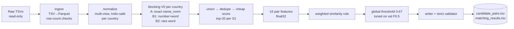
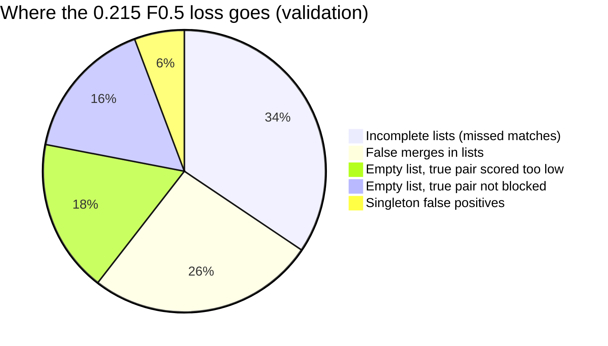
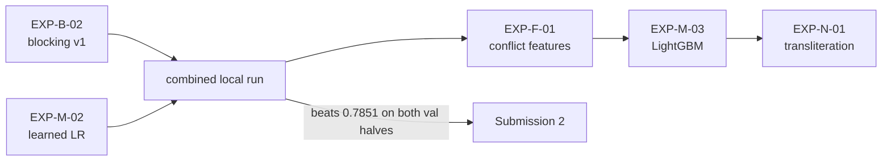

# Submission 1 (EXP-B-01): Execution Report, Error Analysis and Improvement Plan

**Team:** LargeLanguageCoders · **Date:** 2026-09-25 · **Public leaderboard:** **0.751** · **Local validation F0.5:** **0.7851**
**Status:** analysis complete. Every improvement below is a **proposal awaiting team approval** (CLAUDE.md Rules 2, 4 and 9).

> **Where the numbers come from.**
> - Measured by the team's full run: `experiments/runs/EXP-B-01/{metrics.json, threshold_sweep.csv, submission_summary.json}` and `data/processed/{train,test}/scoring_stats.json`.
> - Measured by read-only analysis on the same run: `experiments/runs/EXP-B-01/analysis/{analysis.json, matcher_headroom_probe.json, hypothesis_probe.json, examples.md}`.
> - The public score was reported by the team.
> - Anything marked *estimate* or *simulation* is labelled as such. Nothing is fabricated.
> - Raw record examples are kept out of this tracked file. They are in the git-ignored `analysis/examples.md`.

---

## 1. Executive summary

- **Result.**
  - Submission 1 scored **0.751** on the public leaderboard. The local validation fold (220,682 S1, train-country mix) scored **0.7851**.
  - The pipeline is valid end-to-end. Both output files passed the strict and official validators, with one row per test S1 (1,732,544).
- **Why the leaderboard is lower than local (−0.034).** Mostly the **country mix**.
  - India is our weakest country (**0.692** vs US **0.847**), and it makes up 46.8% of test versus 40% of train.
  - Reweighting validation to the test mix gives **≈0.762** for India+US.
  - The remaining gap is consistent with France scoring around **0.68**. This is an *estimate*; France has no labels.
- **Why the score is 0.785 and not higher.** Two losses, both measured:
  1. **Blocking caps us at 0.910.** 20.2% of true pairs never reach the candidate list.
     - The top-20 cap is not the problem: without any cap, recall only rises from 0.798 to 0.821.
     - The keys are the problem. 34% of the missed pairs have an *identical* legal-suffix-free name (`name_core`), but Block A keys on `name_norm`, which keeps the suffix.
  2. **The hand-weighted scorer loses another 0.125.**
     - A logistic regression trained on the *same features and candidates* reaches **0.8160 vs 0.7851 (+0.031)** on held-out validation halves. Both folds agree.
     - The rule over-trusts name similarity (false merges are mostly *same name, different house number or legal form*). It also under-trusts strong address evidence (true pairs with a Hindi, domain-style or trade name at the same address).
- **What does not help (measured):**
  - threshold / top-1 fallback: +0.0009;
  - exclusivity: +0.0005;
  - per-source thresholds: +0.0008.
  87% of false merges are unmatched distractor records, not records that belong to another S1.
- **Recommended next steps** (all measurable locally, awaiting approval):
  1. **Blocking v1:** add a `name_core` key and a sorted-token key, strip leading zeros from house numbers, turn on the name-token pass, and relax the India caps.
  2. **A learned matcher:** logistic regression, then LightGBM.
  3. **Conflict features:** house-number conflict and legal-form conflict.
  4. **Transliteration** for India.

  The next leaderboard slot should be spent only when local validation clearly beats 0.7851.

---

## 2. What was executed

### 2.1 Pipeline (as configured in `configs/baseline_v0.yaml`)



| Stage | Command | Output |
|---|---|---|
| preprocess | `python -m ber.pipeline.run_baseline preprocess --config configs/baseline_v0.yaml` | `data/interim`, `data/processed` (train 12.5M rows, test 11.7M rows; row counts = file line counts) |
| split | `... split` | `data/splits/val_s1_ids.txt`: 220,682 S1 (10%, stratified country × match-count, seed 42, sha256 `ce1da2d3…`) |
| train | `... train` | `experiments/runs/EXP-B-01/`: tuned threshold **0.67** |
| infer | `... infer` | `data/processed/test/scored/` (20 parts) |
| submit | `... submit` | `output/*.tsv`, strict validation PASS |

### 2.2 Key configuration

- **Blocking:**
  - `top_k` = 20;
  - Block A exact `name_norm` (block ≤ 50);
  - Block B1 (number, word), with the 2 rarest numbers × 4 rarest words per record (block ≤ 50);
  - Block B2 rare address word (pool DF ≤ 20);
  - the name-token pass is **off**.
- **Matcher:** fixed weights over 10 similarity features (name_core_jaccard 2.0, name_ratio 1.5, addr_jaccard 1.5, addr_num_jaccard 1.5, …).
- **Decision:** one global threshold, chosen on validation entity-level F0.5.

### 2.3 Output files (test)

| File | Rows | Empty rows | IDs | Per S1 |
|---|---|---|---|---|
| `candidate_pairs.tsv` | 1,732,544 | 22,501 (1.3%) | 26,089,341 | 15.06 |
| `matching_results.tsv` | 1,732,544 | 192,763 (11.1%) | 4,628,270 | 2.67 |

Test blocking by country (from `scoring_stats.json`):

| Country | S1 | Pool (S2+S3) | Candidates/S1 | Pairs before top-20 cap |
|---|---|---|---|---|
| France | 259,452 | 1,434,993 | 12.19 | 4.79M |
| India | 809,986 | 4,717,565 | 16.54 | 31.70M |
| US | 663,106 | 3,817,031 | 14.37 | 17.02M |

---

## 3. Scores

### 3.1 Headline

| Metric | Value |
|---|---|
| **Public leaderboard F0.5** | **0.751** |
| Local validation F0.5 (threshold 0.67) | **0.7851** |
| Macro precision / macro recall | 0.9226 / 0.6553 |
| Blocking recall (micro) | 0.7983 |
| Oracle F0.5 (perfect decisions on our candidates) | 0.9098 |
| All-empty baseline (predict nothing) | 0.0558 |
| Same run at config threshold 0.75 | 0.7412 |

### 3.2 By country (validation)

| Country | S1 | F0.5 | Precision | Recall | Blocking recall | Oracle | Singleton FP | Empty-on-positive |
|---|---|---|---|---|---|---|---|---|
| India | 88,319 | **0.6918** | 0.869 | 0.566 | 0.779 | 0.892 | 1,609 / 4,935 | 10,133 (11.5%) |
| US | 132,363 | **0.8474** | 0.956 | 0.715 | 0.811 | 0.922 | 1,115 / 7,390 | 5,873 (4.4%) |

### 3.3 By number of true matches (validation)

| True matches | Entities | F0.5 | Precision | Recall | Blocking recall |
|---|---|---|---|---|---|
| 0 (singletons) | 12,325 | 0.779 | — | — | — |
| 1 | 11,916 | **0.600** | 0.847 | 0.649 | 0.806 |
| 2–3 | 90,605 | 0.766 | 0.924 | 0.654 | 0.800 |
| 4–5 | 80,607 | 0.818 | 0.949 | 0.657 | 0.799 |
| 6+ | 25,229 | 0.841 | 0.964 | 0.658 | 0.794 |

Entities with exactly one true match are the worst. Missing that single match costs the whole entity.

### 3.4 Threshold sweep (validation, entity-level)

| Threshold | F0.5 | Precision | Recall | Singleton FP | Empty-on-positive |
|---|---|---|---|---|---|
| 0.55 | 0.656 | 0.687 | 0.718 | 7,088 | 5,456 |
| 0.60 | 0.725 | 0.783 | 0.701 | 5,620 | 7,519 |
| 0.65 | 0.783 | 0.901 | 0.673 | 3,307 | 13,741 |
| **0.67** | **0.785** | 0.923 | 0.655 | 2,724 | 16,006 |
| 0.70 | 0.778 | 0.945 | 0.622 | 2,015 | 19,472 |
| 0.75 | 0.741 | 0.972 | 0.544 | 960 | 28,120 |
| 0.80 | 0.658 | 0.990 | 0.433 | 313 | 45,064 |

The optimum is sharp. True and false pairs overlap heavily in the 0.45–0.70 score range:
- The median true-pair score is 0.815.
- The 99th percentile of false-pair scores is 0.695.

No single threshold can separate them. **This is a scorer problem, not a threshold problem.**

### 3.5 Blocking recall vs candidate budget (validation, uncapped re-blocking)

| Top-K | 10 | 20 (used) | 30 | 50 | 100 | 200 |
|---|---|---|---|---|---|---|
| Blocking recall | 0.764 | **0.798** | 0.811 | 0.818 | 0.821 | 0.821 |
| Candidates/S1 | 8.9 | 15.4 | 20.2 | 26.3 | 30.6 | 31.1 |

Raising K beyond about 30 buys almost nothing. **17.9% of true pairs share no blocking key at all.**

---

## 4. Why the leaderboard (0.751) is below local validation (0.785)

1. **Country mix (measured inputs, simple arithmetic).**
   - Test is India 46.8% / US 38.3% / France 15.0%; train is India 40% / US 60%.
   - Validation India+US reweighted to the test proportions: (0.468·0.6918 + 0.383·0.8474) / 0.851 = **0.762**.
   - So even without France, the test mix alone costs about 0.023 relative to 0.785.
2. **France (estimate).**
   - If India and US score on test what they score on validation, a public score of 0.751 implies France F0.5 ≈ (0.751 − 0.6483) / 0.150 ≈ **0.68**.
   - This relies on several assumptions: the public subset is representative, and India/US generalise from validation to test. Treat it as a rough indicator only.
3. **Test behaves like validation for India and US** (measured, `analysis.json`):

| | Candidates/S1 | Predicted/S1 | Empty prediction | Median top-1 score |
|---|---|---|---|---|
| India, validation | 16.45 | 2.26 | 15.2% | 0.886 |
| India, test | 16.54 | 2.45 | 14.5% | 0.885 |
| US, validation | 14.73 | 2.58 | 9.2% | 0.903 |
| US, test | 14.37 | 2.72 | 8.4% | 0.903 |
| France, test | 12.19 | 3.24 | 7.4% | 0.921 |

   There's no sign of a large distribution break for India and US. France gets *more* predictions per S1 and higher top scores than the other countries, but whether they are correct cannot be measured locally.

4. **Unknowns.** The public/private split sizes and the test's true matches per S1 are *not specified in the provided materials*. Test has about 23% more S2/S3 records per S1 than train.

**Conclusion:** the gap is explained without assuming overfitting. The practical lesson is that **improving India matters most** (the largest test share and the lowest score), and France must be handled by country-agnostic signals.

---

## 5. Why the score is 0.785: loss decomposition

Every validation S1 contributes (1 − F0.5) to the loss. Total loss is 0.2149.

| Entity outcome | Entities | Share | Loss (F0.5 points) |
|---|---|---|---|
| Perfect (F = 1) | 65,004 | 29.5% | 0 |
| **Partial: precise but incomplete** (missed matches) | 103,542 | 46.9% | **0.0740** |
| **Partial: at least one false merge** | 33,406 | 15.1% | **0.0560** |
| **Empty prediction, true pair *was* a candidate but scored below threshold** | 8,310 | 3.8% | **0.0377** |
| **Empty prediction, no true pair among candidates** (blocking) | 7,696 | 3.5% | **0.0349** |
| Singleton wrongly given a match | 2,724 | 1.2% | 0.0123 |

- In the "precise but incomplete" group, **59% of the missing matches never became candidates** (blocking); the other 41% were scored too low (matcher).
- **By stage:** blocking removes up to **0.090** (oracle 0.910); the matcher and decision lose **0.125** on top.



---

## 6. Blocking analysis (why 20% of true pairs never become candidates)

### 6.1 Fate of the 763,556 validation true pairs

| Fate | All | India | US |
|---|---|---|---|
| In top-20 candidates | 79.8% | 77.9% | 81.1% |
| Blocked but cut by top-20 | 2.3% | 3.4% | 1.5% |
| **Never blocked** (no shared key) | **17.9%** | 18.7% | 17.4% |

### 6.2 Why never-blocked pairs were missed (primary cause, measured on all 136,846)

| Primary cause | All | India | US |
|---|---|---|---|
| Share useful address words but **no house number** (B1 needs a number; B2 only fires on words with DF ≤ 20) | 52.8% | 25.0% | **72.8%** |
| Share a number *and* a word, but the key was dropped (block > 50, or not among the 2 rarest numbers / 4 rarest words) | 23.2% | **48.9%** | 4.8% |
| Address empty on one side (only exact-name blocking can help) | 17.3% | 15.4% | 18.6% |
| Non-Latin pool name + weak address overlap | 4.1% | 9.7% | — |
| Only a number shared / nothing shared | 2.6% | 1.0% | 3.8% |

Also measured on these pairs:
- **81% share at least one name token.**
- **Of all true pairs that did not become candidates, 34.4% have an *identical* `name_core`** (the name without legal suffixes). Block A keys on `name_norm`, which keeps `Ltd` / `LLC` / `Pvt`, so these are missed.
- 37.3% have identical *sorted* core tokens, which also covers word order such as `Advanced Parts LLC` vs `Advanced LLC Parts`.
- **Leading zeros in house numbers** (`4126` vs `04126`): among the non-candidate true pairs, stripping leading zeros raises the share with a shared number from 32.5% to **41.3%**.
- ✗ *Hypothesis rejected:* `St` expanded as "SAINT" is **not** a real factor. It appears in about 1% of pairs, whether found or missed.

### 6.3 Interpretation

- US misses come from **names that match and addresses without shared numbers**. That's a name-key problem.
- India misses come from **address keys dropped by the size/rarity caps**. India addresses are long and repetitive.
- Both are fixable in blocking without touching the matcher.

---

## 7. Matcher analysis (why candidate true pairs score too low, and false pairs too high)

### 7.1 True pairs among candidates scored below threshold: 108,382 pairs (14.2% of all true pairs)

| Property | True pairs scored low | True pairs accepted |
|---|---|---|
| **Non-Latin pool name** (script mismatch) | **33.4%** | ≈6% (found-pair sample) |
| Share a name token | 36.3% | ≈87% |
| Name core Jaccard (mean) | 0.21 | 0.83 |
| Address token-set similarity (mean) | **0.85** | 0.95 |
| Share a useful address word / a number | 90.9% / 80.6% | — |

These are pairs where **the address clearly matches but the name doesn't**. Typical causes:
- a Hindi/Tamil/etc. script name (no transliteration in v0);
- a domain-style name such as `triconsulting.com`;
- a completely different trade name at an identical address.

The fixed weights give names about 55% of the total weight, so strong address evidence can't carry these pairs over the threshold.

### 7.2 False merges: 39,489 predicted pairs

| Property | False merges | True matches |
|---|---|---|
| Candidate is an **unmatched distractor** | **86.6%** | — |
| Candidate belongs to *another* S1 | 13.4% | — |
| **Both have house numbers but none shared** (after zero-stripping) | **20.4%** | 2.5% |
| **Legal-form conflict** (e.g. LLP vs Limited, Inc vs Ltd) | **9.7%** | 0.23% |
| Share a name token | 99.7% | — |
| Address number Jaccard (mean) | 0.38 | 0.83 |

False merges are **the same (or nearly the same) business name at a different unit, house number or city, or with a different legal form**. They are mostly distractor records, which is why exclusivity (DEC-008) cannot fix them.

### 7.3 Learned matcher headroom probe (EXP-D-01, diagnostic, measured)

- Setup:
  - same candidates and the same 16 features (+2 blocking scores, +2 interactions);
  - logistic regression;
  - validation S1s split into two halves by a seeded hash;
  - fit and threshold-tune on one half, evaluate on the other, then swap.
- The rule got the identical protocol.

| Matcher | F0.5 held-out half 1 | Half 2 | Mean | Threshold |
|---|---|---|---|---|
| Weighted rule (current) | 0.7849 | 0.7853 | 0.7851 | 0.67 |
| **Logistic regression** | 0.8153 | 0.8166 | **0.8160 (+0.031)** | 0.48 |

The learned weights confirm §7.1 and §7.2:
- **Address token-set similarity is the strongest positive signal.**
- **Name×number interactions are strongly positive.**
- The rule was over-weighting several redundant name features.

A tree model (LightGBM) and the new conflict features should add more; that is *not yet measured*.

### 7.4 Decision-layer what-ifs on existing scores (simulations, measured, not adopted)

| Idea | Validation F0.5 | Δ |
|---|---|---|
| Current | 0.7851 | — |
| Top-1 fallback for empty entities (fallback threshold 0.65) | 0.7860 | +0.0009 |
| Exclusivity among validation S1s | 0.7856 | +0.0005 |
| Separate S2/S3 thresholds (in-sample optimum) | 0.7859 | +0.0008 |
| Perfect decisions on current candidates (oracle) | 0.9098 | +0.125 |

Decision-layer tweaks are **not worth leaderboard slots** now. The gain has to come from better scores and better blocking.

### 7.5 Singletons

- 2,724 of 12,325 singletons (22%) received at least one match, costing 0.0123.
- 92% of those wrongly matched records are unmatched distractors; typically a similar name at a different address.
- The number-conflict and legal-form-conflict signals target exactly this.

---

## 8. Improvement plan (proposals, awaiting approval; in priority order)

Each item is one experiment with one primary change (Rule 5). All are measured on the **same frozen validation split** first (Rule 9). Expected effects are stated as *measured bounds* or *hypotheses*, never as promised scores.

| # | Experiment | Change | Evidence | Expected effect | Effort |
|---|---|---|---|---|---|
| 1 | **EXP-B-02 Blocking v1** | (a) Block A on `name_core` **and** sorted core tokens; (b) strip leading zeros in `addr_nums`; (c) enable the `name_token` pass; (d) relax India caps (`max_block_size` 50→100–200, `max_words` 4→6, `max_nums` 2→3) using the recall-vs-candidates curve | §6.2: 34% of non-candidate true pairs have an identical `name_core`, 81% of never-blocked pairs share a name token, 49% of India misses are dropped keys | Blocking recall from 0.80 upward; the oracle ceiling rises. Realised gain depends on #2 | Low |
| 2 | **EXP-M-02 Learned matcher (LR)** | Train LR on candidates of *train-fold* S1s (not validation). Needs a small `fit` stage that scores a sample of train-fold S1s with stored features | §7.3: **+0.031 measured** on held-out validation halves with the same features | ≈ +0.03 (measured analogue) | Low–medium |
| 3 | **EXP-F-01 Conflict features** | Add `num_conflict` (both have numbers, none shared after zero-strip), `legal_form_conflict`, `state_conflict`, IDF-weighted name overlap, domain-name normalisation | §7.2: number conflict in 20.4% of FPs vs 2.5% of TPs; legal-form conflict 9.7% vs 0.23% | Fewer false merges and singleton FPs | Low |
| 4 | **EXP-M-03 LightGBM** | Same features as #2/#3. Adding the `lightgbm` dependency (MIT) is a decision to record | GBDT captures the name×address interactions the probe found | Hypothesis: beyond LR; to be measured | Medium |
| 5 | **EXP-N-01 Transliteration (India)** | Token dictionary learned from aligned train pairs (Indic token ↔ Latin token), plus features and a blocking key on the transliterated name | §7.1: 33% of low-scored true pairs have a non-Latin pool name; India F0.5 0.692 | Improves India recall; India is 47% of test | Medium |
| — | *Not now* | Threshold/fallback/exclusivity/per-source/per-country thresholds | §7.4: ≤ +0.001 | — | — |

**Suggested order:** #1 and #2 in parallel (different owners), then #3 on top of #2, then #4, then #5. Measure blocking with the learned matcher, because newly blocked pairs are the hard ones that the current rule would reject anyway.



### 8.1 Proposed owners (team to confirm)

| Owner | Task |
|---|---|
| Member A (blocking) | EXP-B-02: new keys, zero-stripping, cap tuning; report the recall-vs-candidates curve by country |
| Member B (models) | EXP-M-02: `fit` stage on train-fold S1s (sample ~200k), LR + threshold, then EXP-F-01 features |
| Member C (infra) | Add the analysis scripts to the standard run; runtime/memory check of the larger candidate sets; packaging skeleton |
| Ayush | Approve experiments and dependencies (lightgbm), gate submissions, France-risk decisions |

---

## 9. Leaderboard plan (Rule 9)

- **Do not spend slots** on threshold, fallback or exclusivity variants. They are measured locally at ≤ +0.001.
- **Submission 2 criterion:** a combined candidate (B-02 + learned matcher) that beats **0.7851** on both validation halves by a clear margin (proposal: ≥ +0.01). Also report the test-mix reweighted India/US score.
- **Purpose of Submission 2:** confirm that local gains transfer, and get the only available France signal. If public − local-reweighted moves sharply, investigate France specifically.
- **Final selection** is decided on local validation plus robustness, not the best public score (the private leaderboard decides).

---

## 10. Rules compliance check

| Rule | Status |
|---|---|
| Raw data read-only | ✔ file timestamps unchanged; all derived data under `data/` |
| No external data or lookups | ✔ only provided data; normalization lists are generic linguistic knowledge (DEC-009, pending confirmation) |
| Output format | ✔ strict + official validators passed; UTF-8 without BOM, LF, 1 row per S1 |
| matches ⊆ candidates; candidates = the scored set | ✔ verified by the strict validator (`--scored-dir`) |
| Country open set | ✔ France discovered from the data; no country feature |
| Model license / size | ✔ no pretrained model; torch is used only as an optimiser in a diagnostic |
| No fabricated metrics | ✔ all numbers from files listed above; estimates labelled |
| No git push / commit | ✔ nothing committed |

---

## 11. Open questions for the team

1. Approve EXP-B-02 and EXP-M-02 (and the `lightgbm` dependency for EXP-M-03)?
2. Is the public/private split size known from the portal? It affects how much weight the 0.751 deserves (*not specified in the provided materials*).
3. Confirm that generic linguistic lists (legal forms, abbreviations) and a transliteration dictionary *learned from the train pairs* are acceptable under fair play (DEC-009 is still pending).
4. Should `data/splits/val_s1_ids.txt` be committed (2.8 MB) to freeze the split for everyone?

## 12. Reproducing this report's analysis

```bash
python scripts/analysis/analyze_exp_b01.py      --config configs/baseline_v0.yaml   # ~3 min, peak ~4 GB
python scripts/analysis/matcher_headroom_probe.py --config configs/baseline_v0.yaml  # ~2 min
python scripts/analysis/hypothesis_probe.py                                          # §6.2 / §7.2 counts
```
