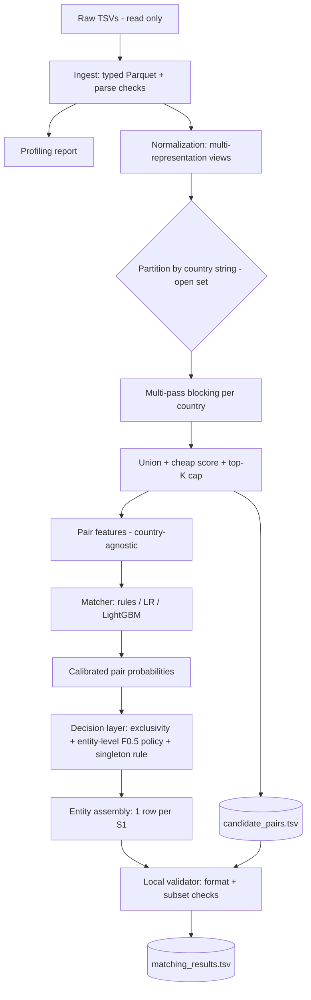
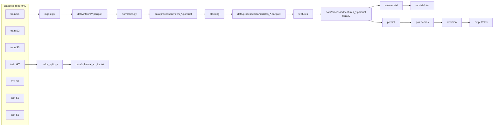
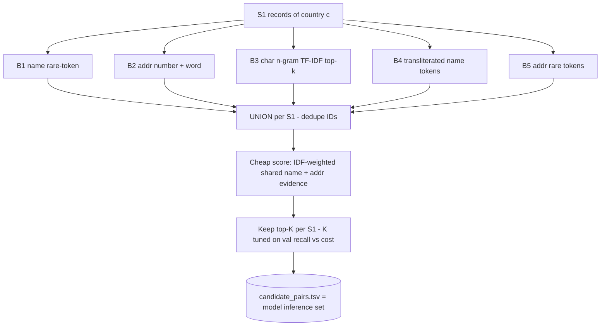
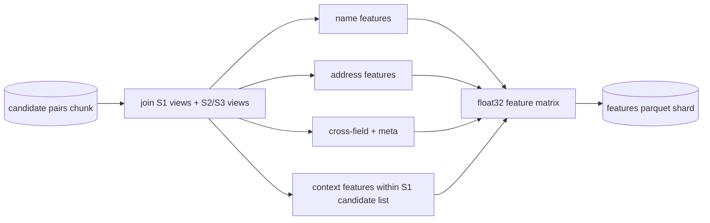
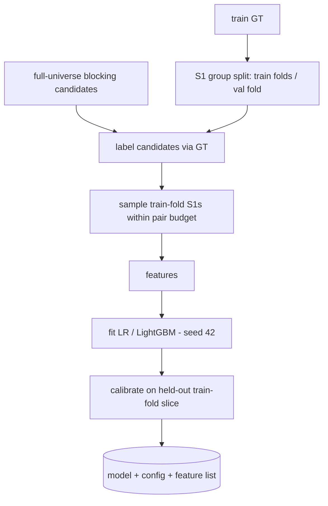
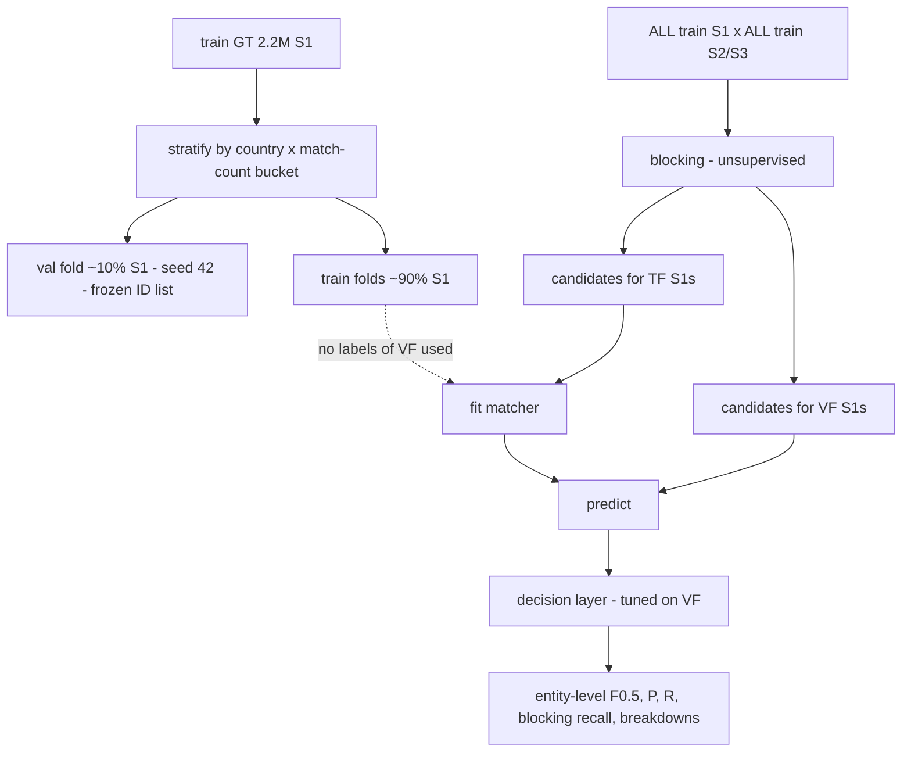
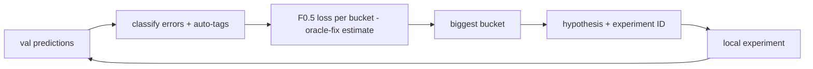
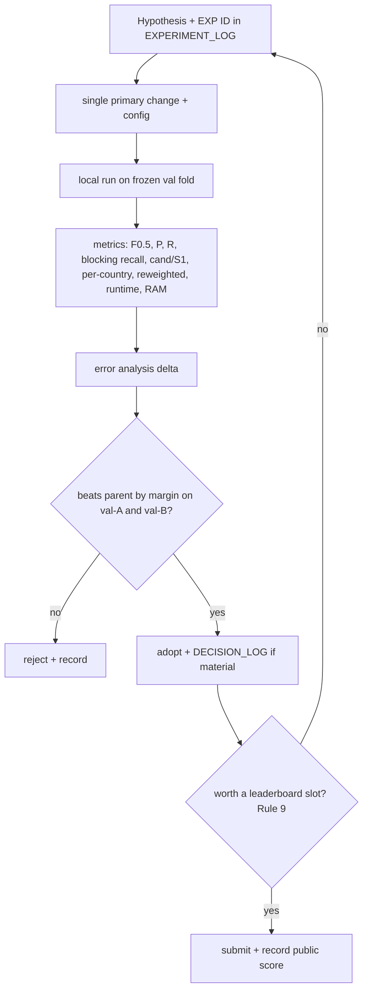

# Business Entity Resolution — Initial Architecture & Strategy Report

**Team:** LargeLanguageCoders · **Technical lead:** Ayush · **Date:** 2026-09-25 · **Phase:** 0 (Audit & Planning)
**Status:** DRAFT for team review. Every decision in here is *Proposed* until the team accepts it (see `docs/DECISION_LOG.md`).

> Sources: `Problem Statement.docx` (the only organizer document in the repo), the raw datasets under `datasets/`,
> and the read-only profiling script `scripts/profiling/profile_datasets.py`
> (seed 42; full-file statistics; pair probes on a random sample of 100,000 S1 entities → 346,678 true pairs).
> Anything not in these materials is marked **"Not specified in the provided materials."**

---

## 1. Executive Summary

- **The task.** For each Source-1 (S1) business, list every matching Source-2 (S2) and Source-3 (S3) record.
  Scoring is **macro per-S1 F0.5**, which weights precision twice as much as recall. Singletons earn 1.0 for an empty list and 0.0 for any prediction.
- **Scale drives the design.** Test has **1.73M S1** entities against **~9.97M S2+S3** records, and train has 2.2M against 10.3M.
  The dev machine has 16 GB RAM, with only ~2–3 GB free during the audit. Memory-aware, sharded processing is mandatory.
- **What the data shows:**
  - The ground truth is a **strict partition**: each S2/S3 record belongs to at most one S1.
  - The mean is **3.46 matches per S1**; 89% of S1 have ≥2 matches, and **5.6% are singletons**.
  - **Country is equal in 100%** of sampled true pairs, so it's a free and safe blocking partition.
  - **Every sampled true pair shares a name token or a non-generic address token.** The blocking-recall ceiling is high, but only if names *and* addresses are both used.
  - Only 25.9% of true pairs have equal normalized names. Name noise includes typos, domain-style names, junk prefixes, word shuffles, legal-suffix games, **Indic-script transliterations** (23.6% of India pairs) and totally different trade names.
    Addresses add abbreviations, reordering, `null` placeholders, 3.3% empty values and native-script state names.
  - **The test set shifts:** India goes from 40% to 47%, US from 60% to 38%, and **France appears at 15%** with zero training examples.
- **Recommended architecture.** A country-partitioned, multi-pass, **recall-first blocking** stage (name tokens, address number+word keys, a character n-gram pass and a transliterated-name pass, unioned and then capped by a cheap score).
  Then a **country-agnostic pairwise similarity model** (rules → logistic regression → LightGBM), then an **entity-level decision layer tuned directly for F0.5**, which also uses S2/S3 exclusivity.
- **The biggest levers**, as hypotheses: blocking recall with a controlled candidate count, handling Indic transliteration, the precision-oriented entity-level decision rule, and robustness on France.
- **Missing organizer files:** `student_resource/utils/validate_submission.py` and `Documentation_template.md` are referenced but **not in the repo**. We need to obtain them.

---

## 2. Problem Understanding

| Concept | Definition in this challenge |
|---|---|
| **Source 1** | The *deduplicated reference* source. Each S1 row is a distinct real-world business (verified: no duplicate normalized name+address+country rows). Clean formatting: Latin script only, no empty addresses. |
| **Source 2 / Source 3** | Independent noisy sources. Each record is one fragment of some business. Several S2/S3 records may describe the same S1 business, and ~26% of S2/S3 records in train match no S1 (distractors). |
| **Ground truth** | `train_ground_truth.tsv`: one row per S1, with `matched_entity_ids` as a comma-separated list of S2/S3 IDs (empty for singletons). |
| **Candidate pair** | An (S1, S2/S3) pair produced by blocking, which the model will score. |
| **Blocking / candidate generation** | Cheap rules that shrink the ~10¹³ possible pairs to a small candidate set per S1 while keeping as many true pairs as possible. |
| **Pair matching** | Scoring each candidate pair with a match probability or similarity. |
| **Singleton** | An S1 entity with no true match. It scores 1.0 only if we predict an empty list. |
| **False positive / false merge** | Predicting an S2/S3 record that doesn't belong to the S1 entity. It lowers per-entity precision, and on a singleton it drops the score from 1 to 0. |
| **False negative / missed match** | A true S2/S3 record we didn't predict. It lowers per-entity recall. |
| **Precision (per entity)** | \|pred ∩ true\| / \|pred\| |
| **Recall (per entity)** | \|pred ∩ true\| / \|true\| |
| **F0.5** | (1+0.25)·P·R / (0.25·P + R), computed per S1 and then averaged over all S1. |

**How the two outputs relate.**
`candidate_pairs.tsv` is the **exact final candidate list the model runs inference over** (the last filtering stage, not an early loose pass).
`matching_results.tsv` is the model's final decision. For every S1 row, **matched ⊆ candidates** (a violation "signals a pipeline bug; the validator warns").
Only `matching_results.tsv` is scored. `candidate_pairs.tsv` is used by organizers to audit blocking (recall ceiling and reduction ratio) and to verify the pipeline.
Both files have exactly one row per test S1 entity.

---

## 3. Dataset Understanding

### 3.1 Files

| File | Size | Rows (parsed = lines−1) | Columns |
|---|---|---|---|
| `datasets/train/train_source1.tsv` | 210.1 MB | 2,206,821 | entity_id, business_name, business_address, country |
| `datasets/train/train_source2.tsv` | 489.3 MB | 5,034,616 | same |
| `datasets/train/train_source3.tsv` | 503.7 MB | 5,285,603 | same |
| `datasets/train/train_ground_truth.tsv` | 127.0 MB | 2,206,821 | source1_entity_id, matched_entity_ids |
| `datasets/test/test_source1.tsv` | 175.0 MB | 1,732,544 | same as sources |
| `datasets/test/test_source2.tsv` | 509.5 MB | 4,887,273 | same |
| `datasets/test/test_source3.tsv` | 506.0 MB | 5,082,316 | same |
| `datasets/.DS_Store` | 6 KB | — | macOS artifact, ignore |
| `Problem Statement.docx` | 25.5 KB | — | the only challenge document |

**Format facts.** UTF-8, **CRLF** line endings, tab-separated. Every line has the expected column count.
A few rows use **RFC-4180 quoting** (`"...""Prestige Feroze"" Building..."`): 4 in train S1, 6 in train S2, and 134/349/330 in test S1/S2/S3.
Reading with `sep="\t"` and default `"` quote handling parses correctly, and parsed row counts equal line counts for all files.
**Do not** read with `quoting=QUOTE_NONE`, or those rows keep literal quotes.
All columns are strings. IDs look like `S{1,2,3}-<3–9 digits>`, are random, and are unique within each file.

### 3.2 Per-source profile (train; test in 3.4)

| Metric | S1 | S2 | S3 |
|---|---|---|---|
| Rows | 2,206,821 | 5,034,616 | 5,285,603 |
| Country US / India | 60.0% / 40.0% | 59.9% / 40.1% | 60.0% / 40.0% |
| Empty name | 0% | 0% | 0% |
| Empty address | 0% | **3.36%** | **3.33%** |
| Unique names (raw → normalized) | 1.54M → 1.52M | 4.40M → 3.95M | 4.65M → 4.19M |
| Name length (chars, median / p99) | 24 / 42 | 25 / 48 | 25 / 50 |
| Name tokens (median / p95) | 4 / 5 | 4 / 8 | 4 / 7 |
| Address length (chars, median / p95) | 41 / 103 | 37 / 96 | 42 / 91 |
| Non-ASCII names | 0% | 15.2% | 11.5% |
| Devanagari names (all / India only) | 0% | 5.4% / 13.4% | 3.0% / 7.5% |
| Other Indic-script names (India only) | 0% | 10.2% | 5.7% |
| Domain-like names (`.com` etc.) | 0% | 4.0% | 4.0% |
| Leading junk (`--`, `<<`, `##`) | 0.14% | 2.2% | 2.2% |
| ALL-CAPS names | 0% | 18.9% | 3.0% |
| Legal suffix present | 63.0% | 48.5% | 51.0% |
| ALL-CAPS addresses (US) | 0% | **89.8%** | 0% |
| Literal `null`/`N/A` in address | 0.005% | 2.6% | 2.5% |
| Native-script state in address (India) | 0% | 13.8% Devanagari + 9.9% other | 13.0% + 9.4% |
| 5-digit token in address (US) | 10.9% | 10.5% | 10.5% |
| 6-digit PIN in address (India) | ~0.02% | ~0.02% | ~0.02% |
| Landmark words (near/opp/behind), India | 13.4% | 11.5% | 8.7% |
| Exact duplicate rows (name+addr+country) | 0 | 25,873 | 18,860 |
| S1 names occurring ≥10 times (share of rows) | 17.0% | 7.9% | 7.7% |

**Observations**
- **S1 is clean, and S2/S3 carry the noise.** Name-side noise can be recovered with normalization. Script differences need transliteration.
- **Postal codes are nearly absent.** Only ~11% of US addresses have a 5-digit token and India almost never has a PIN. ZIP/PIN blocking is **not** a primary strategy.
- **Frequent generic names in S1** (e.g. "primary care group" ×253, "pediatric group" ×222) mean a name alone is ambiguous. Addresses are essential for precision.
- **Style differs by source:** S2 is ALL-CAPS in US addresses (90%) and more often uses native scripts in names. S3 reorders address components and swaps state names for abbreviations (`TN`, `MH`, `Missouri`).

### 3.3 Ground-truth structure (train)

| Metric | Value |
|---|---|
| S1 rows in GT | 2,206,821 (= S1 file; no missing or extra IDs) |
| Total true pairs | 7,638,365 (S2: 3,693,619 · S3: 3,944,746) |
| S2/S3 IDs in more than one S1 list | **0** → the GT is a partition |
| GT IDs missing from source files | 0 |
| Share of S2 / S3 records matched to some S1 | 73.4% / 74.6% → **~26% distractors** |
| **Singleton rate** | **5.58%** (US 5.6%, India 5.6% in sample) |
| 1-to-1 (exactly one match) | 5.40% |
| 1-to-many (≥2 matches) | 89.0% |
| Matches per S1: mean / mean (non-singleton) / median (non-singleton) / max | 3.46 / 3.67 / 4 / 11 |
| Has ≥1 S2 match / ≥1 S3 match / both | 87.0% / 87.9% / 80.5% |

Distribution of matches per S1: 0: 123,247 · 1: 119,157 · 2: 375,212 · 3: 530,841 · 4: 484,115 · 5: 321,957 · 6: 164,868 · 7: 63,968 · 8: 18,680 · 9: 4,205 · 10: 534 · 11: 37.
Per source: up to 5 S2 and up to 6 S3 matches per S1.

### 3.4 Test set and distribution shift

| | Train S1 | Test S1 | Test S2 | Test S3 |
|---|---|---|---|---|
| Rows | 2,206,821 | 1,732,544 | 4,887,273 | 5,082,316 |
| US | 60.0% | **38.3%** | 38.3% | 38.3% |
| India | 40.0% | **46.8%** | 47.3% | 47.3% |
| France | — | **15.0%** | 14.4% | 14.4% |
| S2+S3 records per S1 | **4.68** (US 4.67, IN 4.68) | **5.75** (US 5.76, IN 5.82, FR 5.53) | | |

- **Test has ~23% more S2/S3 records per S1 than train.** Either clusters are larger or there are more distractors. Not specified in the provided materials.
  Either way, expect more candidates per S1 on test, and don't assume train priors (like 5.6% singletons) transfer unchanged.
- **France**: 157k S1 accented names. S2 is ALL-CAPS in 21% of names and 29% of addresses. Addresses use French abbreviations (`R.`, `RUE`, `AV`, `ALLÉE`, `bis`) and legal forms like `SARL`, `SAS`, `SCI`, `EURL`, `S.A.`.
  There's injected accent noise (`Àmicale`, `Pàrenthese`) and almost no postal codes. No Indic scripts.
- **Train/test overlap:** 0 shared IDs and 0 shared normalized S1 records. 2,269 (S2) and 1,979 (S3) normalized test records also appear in train (<0.05%, generic names), which is negligible and **must not be exploited**.

### 3.5 Pair-level evidence (346,678 sampled true pairs vs. random same-country non-pairs)

| Probe | True pairs | Random same-country pairs |
|---|---|---|
| Country equal | **100%** | 100% (by construction) |
| Raw name identical | 4.6% | 0% |
| Normalized name identical | 25.9% | 0% |
| Same sorted name tokens | 32.5% | 0% |
| Name token Jaccard (mean / p10 / p50) | 0.64 / 0.0 / 0.67 | 0.03 / 0 / 0 |
| Share ≥1 name token | 85.7% (US 92.1%, India 76.1%) | 15.6% |
| Share ≥1 non-generic name token | 85.2% | **1.0%** |
| Share ≥1 char 3-gram in name | 91.5% | 33.7% |
| Normalized address identical | 8.3% | 0% |
| Address Jaccard (mean / p10 / p50) | 0.60 / 0.25 / 0.63 | 0.015 / 0 / 0 |
| Share ≥1 non-generic address token | **95.6%** | 20.6% |
| Share ≥1 numeric address token | **78.6%** (India 82.2%) | **1.6%** |
| Either address empty | 4.4% | 4.4% |
| Name script differs (Latin vs non-Latin) | 13.9% (India **23.6%**) | 13.8% |
| **Neither name token nor address token shared** | **0.0%** | 68.1% |
| Min DF of the rarest shared name token ≤100 / ≤1000 | 17.2% / 42.1% of pairs | 0% / 0% |

*Caveat:* the profiling normalization stripped combining marks, which corrupts Indic tokens (see DEC-003). Indic-token statistics are therefore approximate. Latin-script statistics are unaffected.

**What this implies**
1. A **name-only** or **address-only** blocker can't reach high recall. Up to 14% of pairs share no name token, and 4.4% have an empty address.
   The **union** of name-based and address-based passes is required.
2. **Address numeric tokens** are strongly discriminative: 78.6% vs 1.6%. A key such as (house number + address word) is a good blocking key.
3. Rare shared name tokens separate positives from negatives well, but **58% of true pairs share only common tokens** (DF >1000).
   The names come from a small synthetic vocabulary ("Summit", "Apex", "Partners"). Name-token blocking therefore needs DF caps **combined with** address evidence.
4. **Transliteration matters in India**: 23.6% of India true pairs have a non-Latin name against S1's Latin name.

### 3.6 Noise catalogue (observed examples)

| Type | Example |
|---|---|
| Typos | `Maure Wilblims Colombier Inc` · `Dahlia Ponr Reliable` · `HSLL VIEW` |
| Domain-style name | `maurewilliamscolombier.com` · `truefactory.com` |
| Totally different trade name (DBA) | S1 `Wave & Brothers Ltd` ↔ S3 `Belobrixlum` (same address) · `Maure Williams Colombier Inc` ↔ `Dréxkor` |
| Transliteration | `Raj Investments LLP` ↔ `ராஜ் இன்வெஸ்ட்மெண்ட்ஸ் எல்எல்பி` / `Raj Investments எல்எல்பி` |
| Legal-suffix games | `Prvabe (Limited)`, `[LLC]`, `Pvt. … Ltd.`, `M/s …`, `-- APAR … LIMITED CENTER` |
| Junk prefixes / tokens | `--`, `<<`, `##32`, `# # 476` |
| Word shuffle / extra words | `Maure Williams Inc Center`, `Anushree Sangh Sangh` |
| Address reordering | `KANSAS CITY, MO, 630 45ND TERRACE, null` |
| State variants | `NY`/`New York`, `TN`/`Tamil Nadu`/`தமிழ்நாடு`, `MH`/`महाराष्ट्र` |
| Address numbering variants | `Plot No. 65` ↔ `Door No 65`, `HN 31 ROW HOUSE NO B4` |
| Partial addresses | `Bangalore, KA, 32`, empty address |

### 3.7 Leakage and data-quality checks

- **No row-order leakage:** Spearman correlation of S1 vs matched-record row positions = 0.0005.
- **No ID leakage:** ID-number correlation = 0.003, and the share with the same numeric ID is 0.
- **No train/test ID overlap.**
- S2/S3 contain exact duplicate rows (~0.4%). Whether they belong to the same S1 was not measured, so that's a follow-up.
- Data-quality issues to handle: literal `null`/`N/A` tokens, junk prefixes, doubled words, `(lndia)` l/I swaps, and ALL-CAPS.

---

## 4. Challenge Constraints

(Consolidated in `CLAUDE.md`, "HARD CONSTRAINTS".)

| Constraint | Source | Notes |
|---|---|---|
| TSV, tab-separated, ID lists comma-separated, no quoting | PS "File Format", "Output Format" | |
| `matching_results.tsv` columns: `source1_entity_id`, `matched_entity_ids` | PS | exact header names |
| `candidate_pairs.tsv` columns: `source1_entity_id`, `candidate_entity_ids` | PS | |
| One row per test S1; missing S1 → rejection; duplicate S1 rows → rejection | PS Constraints | both files |
| Empty list for singletons / no candidates | PS | |
| No duplicate IDs within a list → rejection | PS | |
| Only S2/S3 IDs that exist in the test set; no S1 self-matches | PS | |
| Matches ⊆ candidates | PS | validator warns |
| `candidate_pairs` = exact final model-inference set | PS | |
| Official validator `utils/validate_submission.py` (stdlib) | PS | **Not present in repo** |
| Model license MIT/Apache-2.0, ≤8B parameters | PS Constraints | Library license policy: *Not specified in the provided materials* |
| No external lookup / augmentation | PS Fair Play | disqualification |
| Country is an open set; France only in test | PS Data Description | no hard-coding, filtering or one-hot |
| Public LB = subset of test, private = remainder, final = private | PS | split sizes: *Not specified* |
| Leaderboard submission count limit | — | **Not specified in the provided materials** (team states 5/day) |
| Final zip structure (`output/`, `code/business_entity_resolution/{src,README.md,requirements.txt}`, `Documentation_template.md`) | PS Final Submission Package | must regenerate outputs end-to-end |
| Runtime / hardware limits for reproduction | — | *Not specified in the provided materials* |
| Deadline / timeline | — | *Not specified in the provided materials* |
| Whether unlabeled **test** data may be used for unsupervised statistics (IDF, vocab) | — | *Not specified.* It's unavoidable for blocking the test set. See Questions. |

## HARD CONSTRAINTS — NEVER VIOLATE

1. Output **TSVs** with the exact headers, **one row per test S1**, **no duplicate S1 rows**.
2. **Empty** `matched_entity_ids` for predicted singletons (and empty `candidate_entity_ids` when blocking finds nothing).
3. **No duplicate IDs** in a list. **Only valid test S2-/S3- IDs**. **No S1 IDs**.
4. **matches ⊆ candidates**, and `candidate_pairs.tsv` = the exact set the model scored.
5. **Country is open-set.** Never enumerate {US, India}. France must flow through the whole pipeline.
6. **No external business lookup, APIs, geocoding or internet augmentation.**
7. Any model: **MIT/Apache-2.0, ≤8B params**.
8. Reproducible end-to-end from `code/business_entity_resolution/` alone, with pinned `requirements.txt`.
9. Raw data is read-only.
10. Validate every output locally before spending a leaderboard slot.

---

## 5. Evaluation Metric

### 5.1 Exact formula
Per S1 entity *e*, with predicted set Pₑ, true set Tₑ, TP = |Pₑ∩Tₑ|, k = |Pₑ| and n = |Tₑ|:

- If n = 0: score = 1 if k = 0, else 0.
- Else: P = TP/k (0 if k = 0), R = TP/n, **F0.5 = 1.25·P·R / (0.25·P + R)**, which equals

  **F0.5 = 1.25·TP / (0.25·n + k)** (0 when TP = 0).

  Check against the official example: TP=2, n=2, k=3 → 2.5/3.5 = **0.714** ✓.
- Final score = **mean over all S1 entities** (macro).

### 5.2 Why precision dominates, in numbers (entity with n = 4)

| Prediction | P | R | F0.5 |
|---|---|---|---|
| 4 correct | 1.00 | 1.00 | **1.000** |
| 3 correct | 1.00 | 0.75 | 0.938 |
| 2 correct | 1.00 | 0.50 | 0.833 |
| 1 correct | 1.00 | 0.25 | 0.625 |
| 4 correct + 1 wrong | 0.80 | 1.00 | 0.833 |
| 3 correct + 1 wrong | 0.75 | 0.75 | 0.750 |
| 4 correct + 2 wrong | 0.67 | 1.00 | 0.714 |
| nothing | — | 0 | 0.000 |

One false merge costs about as much as missing **two** true matches.
From the closed form, adding one more prediction with probability *p* of being correct raises expected F0.5 only if

> **p > TP/(0.25·n + k) = F_current / 1.25**

So with 3 confident correct predictions out of 4, a 4th candidate needs p > 0.75. When the current F is 0.5, p > 0.4 is enough.
**The optimal threshold depends on the entity. A single global cut is a first approximation, not the optimum.**

### 5.3 Singletons
Singletons are 5.6% of train S1. An all-empty submission scores exactly the singleton rate (≈0.056 on train).
For a singleton, *any* prediction costs a full 1.0. For a non-singleton, predicting nothing costs a full 1.0.
So the **first** prediction for an entity is a decision between "is this S1 a singleton?" and "is my top candidate correct?". It needs its own rule (§13).

### 5.4 Why entity-level evaluation matters
Pairwise F1 over-weights large clusters (an S1 with 11 matches counts 11×), ignores singletons completely, and treats FPs and FNs symmetrically.
The leaderboard does the opposite on all three counts. A model that looks better on pairwise F1 can score worse on the leaderboard.

### 5.5 Local evaluator (spec — to be implemented in Phase 2)
`evaluate(pred: dict[s1 → set], truth: dict[s1 → set], candidates: dict[s1 → set] | None) → report`:
- **Primary:** macro F0.5 with the official conventions.
- Macro P (entities with k>0 only, plus the count of empty predictions), macro R (entities with n>0).
- **Blocking recall** (micro: true pairs in candidates / all true pairs) and **entity-level recall ceiling** (F0.5 of an oracle that picks exactly Tₑ∩Cₑ).
- Candidates per S1: mean, median, p95, p99, max. **Reduction ratio** = 1 − |C| / (Σ_country |S1_c|·|S2S3_c|).
- Breakdowns by country, by n bucket (0, 1, 2–3, 4–5, 6+), by target source, and singleton accuracy (TN/FP counts).
- **Test-mix-reweighted F0.5** = 0.468·F_India + 0.383·F_US + 0.150·F_proxy, where the France proxy is reported separately and never presented as measured.
- Unit tests: the official example, all-empty, all-perfect, singleton FP, and an empty prediction on a non-singleton.

---

## 6. Why F0.5 Changes Our Strategy

1. **Blocking should be recall-first, but the decision layer must be precision-first.** Losing a pair in blocking caps recall. Keeping bad candidates is fine as long as the model rejects them.
2. **Predict fewer, surer matches.** The expected-value break-even is p > F/1.25, so low-confidence tail candidates should be dropped.
3. **Ambiguity is the enemy.** Frequent generic S1 names ("pediatric group" ×222) plus empty S2/S3 addresses (3.3%) are exactly where false merges come from. Name-only evidence needs to be **very** strong.
4. **Singleton detection is a separate objective.** 5.6% of entities are all-or-nothing.
5. **Exclusivity is a precision tool.** Each S2/S3 record belongs to at most one S1 (in train), so conflicts can be resolved in favour of the best-scoring S1.
6. **Tune thresholds on the entity-level metric**, never on pairwise F1 or accuracy.

---

## 7. Proposed Architecture

The initial hypothesis largely holds up. The data motivated these changes:
- **(a)** a hard country partition (DEC-002)
- **(b)** a transliteration representation for Indic names (DEC-003)
- **(c)** a candidate-ranking cap as the final blocking stage, so `candidate_pairs.tsv` = exactly what's scored
- **(d)** an entity-level decision layer with exclusivity resolution (DEC-007, DEC-008)
- **(e)** memory-aware Parquet/shard processing (DEC-010)

### 7.1 Overall system



### 7.2 Data flow



---

## 8. Candidate Generation / Blocking Strategy

### 8.1 Principles
- **Partition by country first.** 100% of true pairs are same-country, and it cuts the comparison space about 2.5×. Iterate over whatever countries exist.
- **Several complementary passes, unioned.** Each pass targets a different noise type. Measure each pass's *marginal* recall.
- **Control block sizes with document-frequency (DF) caps.** Skip keys whose posting list exceeds a cap (the cap is a tuned hyper-parameter), so common tokens like "limited" or "group" never create huge blocks.
- **The final stage is a cheap-score top-K cap per S1** (e.g. IDF-weighted shared-token score). That output *is* `candidate_pairs.tsv`.
- **Blocking is unsupervised**, apart from tuning caps and K on validation recall, so it can run on the full train universe without leakage.

### 8.2 Candidate passes (priority order; each is an experiment)

| Pass | Key | Targets | Evidence |
|---|---|---|---|
| **B1 Name rare-token** | (country, core-name token) with DF ≤ cap | typos elsewhere in the name, shuffles, suffix games | 85% of pairs share a non-generic name token vs 1% random |
| **B2 Address number + word** | (country, numeric address token, co-occurring address word/city token) | trade-name changes, transliterated names | 78.6% share a numeric token vs 1.6% random |
| **B3 Name char n-gram** | TF-IDF char 3–4-grams of `name_concat`, top-k cosine within country (chunked sparse matmul) | typos, domain-style names, spacing | 91.5% share a char 3-gram |
| **B4 Transliterated name** | B1 keys computed on `name_translit` for non-Latin names | Indic scripts | 23.6% of India pairs are script-mismatched |
| **B5 Address rare-token** | (country, rare address token pairs) | addresses with no numbers | 95.6% share a non-generic address token |
| B6 (later) Embedding kNN | multilingual sentence embeddings (Apache/MIT, ≤8B) | residual misses after B1–B5 | only if error analysis shows a residual blocking gap |



### 8.3 Recall vs reduction trade-off
More passes and larger K raise recall, but candidates/S1 grows, and so do feature compute, memory and hard negatives.
F0.5 caps us at the **entity-level recall ceiling**, while precision is controlled downstream. So target **≥98–99% blocking recall**, provided candidates/S1 stays within a budget that fits feature computation.
The budget is *proposed* as mean ≤50 and p99 ≤200, to be confirmed by measurement.
The operating point is chosen from a **recall-vs-candidates curve** per pass combination.

### 8.4 Blocking metrics (every blocking experiment reports all of these)
Blocking recall (micro), entity-level recall ceiling, % of S1 with every true match captured, candidates/S1 (mean, median, p95, p99, max), total pairs, reduction ratio, runtime, peak RAM.
Break down by country, by target source (S2 vs S3), by name script (Latin vs non-Latin), and for pairs with an empty address.
Also log **candidates/S1 on test** as a sanity check. Test has a denser pool, so expect higher counts.

---

## 9. Normalization Strategy

**Principle: add views, never overwrite.** Each view serves a purpose.

| View | Construction | Used by |
|---|---|---|
| `name_raw` | original | exact-match features, audit |
| `name_norm` | Unicode NFKC → casefold → **accent-strip only for Latin script** → `&`→`and` → punctuation to space → squeeze | most similarity features |
| `name_tokens` | split of `name_norm` | Jaccard, B1 |
| `name_core` | `name_tokens` minus legal forms (inc, llc, ltd, limited, pvt, private, corp, co, llp, sarl, sas, sa, sci, eurl, …) and noise tokens (m/s); legal-form list **mined from the data** by frequency + a small generic list | primary name comparison |
| `name_concat` | alphanumeric-only `name_core` with no spaces; `.com`, `www` stripped | domain-style names, spacing typos |
| `name_translit` | for non-Latin tokens, a **token dictionary learned from aligned train pairs** (e.g. `प्राइवेट`→`private`, `लिमिटेड`→`limited`) + a rule-based Indic→Latin character fallback (needs a license check) | B4, name features |
| `legal_form` | canonical legal form(s) (ltd/limited/pvt → `ltd`, `pvt`) | legal-form agreement feature |
| `addr_norm` | same as `name_norm`; drop `null`, `n/a`, `##`; expand common abbreviations (rd→road, st→street, ave→avenue, r.→rue, av→avenue, bd→boulevard, no/door no/plot no/hn → `no`) | similarity |
| `addr_numbers` | numeric and alphanumeric tokens (`65`, `b4`, `a-68`→`a68`, `14/15`) | B2, number-overlap features |
| `addr_words` | non-numeric address tokens minus state/country tokens | Jaccard, B5 |
| `addr_state` | canonical state from abbreviations, full names or native script (a mapping **learned from aligned train pairs**, e.g. `MH`↔`maharashtra`↔`महाराष्ट्र`) | consistency feature |
| `addr_postal` | 5-digit / 6-digit tokens when present (rare) | minor feature |

**Why multiple representations?** Each view is lossy in a different way. `name_core` removes suffixes that are noise *here* but still carry a weak signal (Pvt vs Inc). `name_concat` fixes spacing but kills token boundaries. Transliteration introduces errors. Keeping them all lets features and blocking use the right view per noise type, and lets error analysis trace mistakes back.
**The concrete warning from this audit:** a generic "strip combining marks" step silently destroyed every Devanagari/Tamil word.

---

## 10. Pair Feature Engineering

All features are **country-agnostic** similarities or counts (no token identities, no country one-hot), so they transfer to France.



| Group | Priority-1 (baseline) | Priority-2 (after error analysis) |
|---|---|---|
| **Name** | exact norm eq · core eq · concat eq · token Jaccard (norm, core) · token-sort ratio · partial ratio · Jaro-Winkler on core · char-3gram Jaccard on concat · IDF-weighted token overlap · max IDF of shared token · length diff · token count diff · translit Jaccard (if non-Latin) · legal-form agreement | TF-IDF cosine (char) · first-token eq · acronym match (`LG` vs `Lucky Goldstar`) · domain-name containment |
| **Address** | norm eq · token Jaccard · IDF-weighted overlap · numeric-token Jaccard · house-number eq · any numeric shared · state agreement (canonical) · empty flags (either/both) · length diff | char TF-IDF cosine · street-name similarity after removing numbers and state · landmark overlap · postal eq |
| **Cross-field** | name_sim × addr_sim interactions (for LR) · "strong name & empty address" flag · "weak name & strong address" flag · target source (S2/S3 — allowed, not country) · S2/S3 script is non-Latin | |
| **Context** (within the S1 candidate list) | rank of this candidate by cheap score · score gap to best · number of candidates · S1 name frequency in S1 (ambiguity) · candidate name frequency in pool | **exclusivity context**: is this S1 the best-scoring S1 for this S2/S3 record, and by what margin |

Libraries: `rapidfuzz` (MIT) for fast similarity. It isn't installed, so adding it is a decision for the team to approve.

---

## 11. Matching Model Strategy

| Model | Why it may work | Weaknesses | Experiment | Cost | Worth it? |
|---|---|---|---|---|---|
| **Deterministic / rules** (e.g. core-name eq & address overlap) | high precision, interpretable, instant | poor recall (only 26% normalized-name equality) | EXP-M-01 | trivial | **Yes**: floor and sanity check |
| **Weighted similarity rule** | fast baseline, no training | hand-tuned weights, weak interactions | EXP-M-02 | low | **Yes**: Baseline 1 |
| **Logistic regression** | calibrated, interpretable, robust to shift | linear, needs interaction terms | EXP-M-03 | low | **Yes**: Baseline 2 |
| **GBDT (LightGBM)** | non-linear interactions, missing-value handling, fast on millions of rows | may overfit to US/India feature distributions | EXP-M-04 | medium (CPU) | **Yes**: likely main model |
| **TF-IDF / char-ngram similarity** | typo-robust | this is a feature/blocking method, not a model | inside features | medium | Yes, as features |
| **Embedding similarity** (multilingual MiniLM/LaBSE-type, Apache-2.0; license must be verified per checkpoint) | transliteration, semantics | GPU time for 10M records (6 GB GPU), synthetic names carry little semantics | EXP-A-xx | high | Only if residual errors are transliteration/semantic |
| **Cross-encoder / small LLM (≤8B, MIT/Apache)** | best on hard pairs | far too slow for millions of pairs; only viable on a small uncertain subset | — | very high | **Do not build yet** |
| **Two-stage ranking** (cheap model prunes, strong model decides) | cuts compute | more complexity | later | medium | If features become expensive |
| **Ensembles** | small gains | complexity, reproducibility | late | medium | Nice-to-have |

**Training data for the matcher.** Sample S1 entities from the train folds (e.g. 200–300k S1 → ~6–15M candidate pairs, depending on K). Use candidates exactly as blocking produces them, so negatives are realistic hard negatives. Labels come from the GT. The seed is fixed.



---

## 12. Decision / Threshold Strategy

Order of experiments (each must beat the previous one on validation F0.5):
1. **Global probability threshold τ**, swept on validation *entity-level* F0.5. This is the baseline.
2. **Exclusivity resolution** (DEC-008): each S2/S3 ID is kept only for its argmax S1, optionally with a margin requirement.
3. **Expected-F0.5 top-k per entity:** sort candidates by calibrated p, pick the k that maximizes E[F0.5], approximating n by Σp plus an estimate of blocking misses. The break-even rule p > F/1.25 (§5.2) is the intuition.
4. **Relative margin:** drop candidates whose p is far below the entity's best.
5. **Source-aware τ (S2 vs S3):** only if validation gains are clear. **Country-aware τ: avoid**, because France has no labels. If used at all, it only applies to seen countries, and France falls back to the global/conservative rule.

**Calibration.** Use isotonic or Platt calibration on a held-out slice, because the expected-F policies need calibrated probabilities.

---

## 13. Singleton Strategy

- A predicted singleton is an entity whose best candidate fails the decision rule. There's no separate classifier to start with.
- **Experiment:** a singleton gate on entity-level features (best p, 2nd-best p, number of candidates, S1 name frequency, whether the top candidate is "taken" by another S1). Compare it with "decision layer only".
- Report the singleton confusion (TN/FP) and the non-singleton empty-prediction count separately. Both are all-or-nothing.
- Test has 23% more S2/S3 per S1. The singleton rate on test is **unknown**, so don't hard-code 5.6%.

---

## 14. Validation Strategy

See DEC-004.



- **Why full-universe blocking?** Validation S1s must compete against the *same density* of S2/S3 records and the other S1s (for exclusivity) that test S1s face. Disjoint mini-universes would make validation unrealistically easy.
- **Threshold overfitting control:** tune τ on half of the val fold and confirm on the other half (val-A / val-B). Report both.
- **Unseen-country proxy:** leave-one-country-out (train on US → evaluate on India, train on India → evaluate on US). The drop estimates France risk and guides how conservative to be.
- **Leakage checks:** no ID-derived features; no row-order features; IDF/vocab statistics computed without labels; the val fold is never used for fitting (only for τ, with the A/B guard).
- **Test-mix reweighting:** always report the India/US-reweighted score next to the raw one.

---

## 15. Error Analysis Strategy

Every validation error gets a row: `s1_id, cand_id, type, p, rank, features…, auto_tags`.

| Type (primary) | Definition |
|---|---|
| Blocking miss | true pair not in candidates |
| Missed match | true pair in candidates, not predicted |
| False merge | predicted pair not in truth |
| Singleton FP | any prediction for a singleton S1 |
| Empty-on-positive | no prediction for a non-singleton S1 |

Auto-tags (heuristic, multi-label): `translit` (script mismatch), `typo` (high char-sim but token mismatch), `abbreviation`, `domain_name`, `trade_name` (name sim ≈ 0 & address sim high), `missing_address`, `ambiguous_name` (S1 name freq ≥10), `multi_plausible` (≥2 candidates above τ), `junk_tokens`, `state_variant`, `other`.
The **error-budget report** gives F0.5 loss attributable to each bucket (the score gained by an oracle fix of that bucket) and names the single biggest bucket. That's what gets optimized next.
We review 50 random examples per top bucket by hand every iteration.



---

## 16. Experimentation Strategy



- Fixed seeds, configs under `configs/`, and a run folder per experiment with `config.yaml`, `metrics.json`, git hash, runtime and peak RAM.
- **One primary change per experiment.** Compare against a named parent.
- **Adoption margin:** ≥ +0.002 F0.5 on both val halves, or a meaningful compute/memory win at equal score. The number is a proposal for the team to confirm.
- **Speed matters:** a "dev" config on ~50k val S1 for fast iteration, and a "full" config for final numbers.

---

## 17. Leaderboard Submission Strategy

- The leaderboard gives **the only feedback on France**, and it's measured on a *subset* of test (split size not specified). Submissions are for (a) confirming the local→public correlation, (b) testing decisions local validation *can't* answer (France behaviour, test-density effects), and (c) banking strong candidates.
- **Never** use the leaderboard for anything local validation can measure (feature tweaks, K, τ on US/India).
- **Final selection:** choose on **local validation + robustness**, not the best public score, because the private LB decides.
- **Submission record (in EXPERIMENT_LOG):** slot #, date, EXP ID, local F0.5 (raw and reweighted), public score, delta from the local prediction, and what we learned.
- **The first submission's purpose** is pipeline validity plus local↔public calibration.

## 18. Five-Submission Daily Strategy

(The 5/day limit is team-stated. *Not specified in the provided materials.*)

| Slot | Default use |
|---|---|
| 1 | Best locally validated model (the day's "bank" submission) |
| 2 | Paired A/B on **one** question that can't be answered locally (e.g. France-conservative τ vs global τ; exclusivity on vs off) |
| 3 | Second arm of the A/B, or a follow-up |
| 4 | Reserve for a fix or regression check after major pipeline changes |
| 5 | **Keep unused** until late in the day (buffer against format failures and late wins) |

Rules: run our validator (and the official one when we get it) before every upload. Don't submit two changes at once. Log the outcome within the hour.

---

## 19. Team Roles

| Person | Role | Responsibilities | Deliverables | Depends on | Hands off to | Acceptance criteria |
|---|---|---|---|---|---|---|
| **Ayush** | Tech Lead / Strategy / Evaluation / Integration | owns the architecture, the metric definition, split design, decision layer, experiment approval, integration and final selection | `src/ber/evaluation/metrics.py` (+tests), `data/splits/*`, decision-layer module, review of all PRs, daily submission plan | GT only (starts now) | everyone uses the evaluator | evaluator reproduces 0.714 and edge cases; split frozen and documented; every adopted change has an EXP ID |
| **Member A** | Data + Normalization + Blocking | Parquet ingest, normalization views, transliteration dictionary mining, blocking passes, recall curves | `src/ber/data/ingest.py`, `src/ber/normalization/*`, `src/ber/blocking/*`, blocking report | raw data (now); evaluator for recall (Ayush, ~2h) | candidates Parquet → Member B | unit tests on the noise catalogue; blocking recall ≥ target at an agreed candidates/S1 budget on the val fold; runs within RAM |
| **Member B** | Pair Features + Matching Models | feature library, rule baseline, LR, LightGBM, calibration, feature importance | `src/ber/features/*`, `src/ber/models/*`, model cards | candidate schema (agree on day 1; can start on a toy candidate set from exact-name joins) | scores → Ayush's decision layer | features computed in chunks within RAM; LR and GBDT reported with EXP IDs; no country or ID features |
| **Member C** | Evaluation infra + Experiment runner + Submission pipeline | our own **format validator** (mirrors the official rules until we get the official script), TSV writer, experiment runner/config system, error-analysis report, final zip packaging, README/requirements, methodology doc draft | `src/ber/submission/*`, `scripts/run_experiment.py`, `scripts/validate_submission_local.py`, `scripts/package_submission.py`, `docs/Documentation_template.md` (filled) | evaluator API (Ayush); test S1 IDs (now) | runner used by A and B | a trivial all-empty test submission passes our validator; the package script builds a zip matching the required tree; experiment runner writes `metrics.json` |

Parallel work starts immediately for all four. Integration points are the **candidate schema** (A→B), the **score schema** (B→Ayush), and the **evaluator API** (Ayush→all).

---

## 20. Development Phases

| # | Phase | Objective | Inputs | Outputs | Owner | Depends | Acceptance | Priority |
|---|---|---|---|---|---|---|---|---|
| 0 | Repo & data audit | understand the problem | docs, data | this report, governance files | Claude/Ayush | — | team review | **Done (pending review)** |
| 1 | Ingest + profiling v2 | typed Parquet, fixed Indic normalization in profiling | raw TSVs | `data/interim/*.parquet`, parse checks | A | 0 | row counts = lines−1 for all files | MUST |
| 2 | Validation framework | split + evaluator + validator | GT, test S1 | split IDs, `metrics.py`, validator, tests | Ayush + C | 0 | tests pass; all-empty scores = val singleton rate | MUST |
| 3 | Normalization | multi-view records | Parquet | views Parquet, unit tests | A | 1 | noise-catalogue tests pass | MUST |
| 4 | Blocking baseline | B1 + B2 union + top-K | views | candidates | A | 2, 3 | recall/candidates curve reported | MUST |
| 5 | Candidate recall analysis | find residual misses, add B3–B5 | candidates, GT | blocking report, chosen operating point | A + Ayush | 4 | chosen point recorded in DECISION_LOG | MUST |
| 6 | Pair features | P1 feature set | candidates, views | features Parquet | B | 4 (schema), 3 | computed within RAM on val and train sample | MUST |
| 7 | Baseline matchers | rule → LR → LightGBM | features, labels | models + EXP entries | B | 6 | val F0.5 reported for each | MUST |
| 8 | Decision optimization | τ sweep, exclusivity, singleton rule | scores | decision config | Ayush | 7 | val-A/val-B agreement | MUST |
| 9 | Submission 1 | end-to-end on test | test data | both TSVs, validated | C + all | 8 | validator PASS; public score logged | MUST |
| 10 | Error analysis | biggest error buckets | val predictions | error budget report | Ayush + C | 9 (or 8) | top-3 buckets quantified | MUST |
| 11 | Improvements | features / translit / blocking for top bucket | report | EXP entries | A + B | 10 | measured gains only | SHOULD |
| 12 | Submissions 2+ | confirm gains / France policy | best models | LB scores | Ayush | 11 | Rule 9 justification for each | SHOULD |
| 13 | Advanced | embeddings, expected-F top-k, ensembles | residual errors | EXP entries | B + Ayush | 12 | justified by error budget | NICE |
| 14 | Final model | freeze config | all | final config + outputs | Ayush | 12/13 | chosen on local + robustness | MUST |
| 15 | Reproducibility & packaging | zip, README, requirements, methodology doc | final config | `<team>_submission.zip` | C | 14 | clean-machine rerun regenerates both TSVs; validator PASS | MUST |

---

## 21. Project Structure

```text
LargeLanguageCoders/
├── README.md                     # (Phase 2) how to run
├── CLAUDE.md                     # operating rules for Claude sessions  ✅
├── .gitignore                    # ✅
├── requirements.txt              # pinned (Phase 1)
├── configs/                      # yaml configs per experiment / pipeline stage
├── docs/
│   ├── DECISION_LOG.md  ✅  DEVELOPMENT_LOG.md  ✅  EXPERIMENT_LOG.md  ✅
│   ├── methodology/              # drafts for Documentation_template.md
│   └── problem_statement/        # (local only, gitignored if organizer docs are copied here)
├── datasets/                     # organizer raw data — READ-ONLY, gitignored (kept in place)
├── student_resource/             # organizer validator + template once obtained — gitignored
├── data/                         # gitignored
│   ├── interim/                  # typed Parquet copies of raw
│   ├── processed/                # views, candidates, features
│   └── splits/                   # frozen split ID lists (small; consider tracking)
├── src/ber/                      # "business entity resolution" package → copied to code/business_entity_resolution/src
│   ├── data/  normalization/  blocking/  features/  models/
│   ├── evaluation/  decision/  inference/  submission/
│   └── utils/
├── scripts/
│   ├── profiling/profile_datasets.py   ✅
│   ├── run_experiment.py  validate_submission_local.py  package_submission.py  (Phase 2)
├── experiments/runs/<EXP-ID>/    # gitignored run artifacts
├── models/                       # gitignored binaries
├── reports/
│   ├── INITIAL_ARCHITECTURE_AND_STRATEGY.md  ✅
│   └── profiling/profile_summary.json        ✅ (gitignored: contains raw record examples)
├── output/                       # final TSVs (gitignored; built by pipeline)
└── tests/                        # unit tests (metric, validator, normalization)
```

Changes from the suggested layout: `datasets/` is kept in place instead of being moved to `data/raw/`, which avoids touching raw data. A `decision/` module and a `data/splits/` folder are added. Code lives in a package `src/ber/` so it maps 1:1 onto the required `code/business_entity_resolution/src/`.

**`.gitignore` summary.**
- **Ignored:** raw datasets (`datasets/`, `*.tsv` except test fixtures), organizer docs (`Problem Statement.docx`, `student_resource/`), derived data (`data/interim`, `data/processed`, Parquet/NumPy), outputs and zips (regenerable; can exceed GitHub's 100 MB file limit), model binaries, run artifacts, profiling JSON (contains raw rows), environments, caches, secrets, OS/editor files.
- **Tracked:** all source, configs, docs, reports, tests, `CLAUDE.md`, and the filled methodology doc.
- **Note:** final output TSVs are deliberately *not* tracked. `scripts/package_submission.py` will assemble the zip from `output/`.

---

## 22. Risks

| Risk | Likelihood | Impact | Mitigation |
|---|---|---|---|
| **RAM exhaustion** (~2–3 GB free) | High | Blocks progress | Parquet, per-country shards, float32, chunked features; close other apps; see if a teammate has a bigger machine |
| **France generalization** (no labels) | High | 15% of test | country-agnostic features, leave-one-country-out proxy, conservative decisions, public-LB A/B |
| **Blocking recall ceiling too low** | Medium | caps score | multi-pass union with a per-pass recall ledger |
| **Candidate explosion** (generic names, denser test pool) | Medium | runtime/RAM | DF caps, top-K, monitor test candidates/S1 |
| **Threshold overfit / public-LB overfit** | Medium | private LB drop | val-A/B, few LB decisions, choose on local |
| **Transliteration** of Indic names | High (India = 47% of test) | recall/precision in India | learned token dictionary + char fallback; address-driven evidence |
| **Exclusivity assumption false on test** | Low–Med | precision | adopt only if validated; LB A/B |
| **Missing official validator/template** | Certain (now) | rejected submission / doc gaps | obtain files; our own validator mirrors the rules |
| **License non-compliance** (models / libraries) | Low | disqualification | license register in the methodology doc; MIT/Apache models only |
| **Non-reproducible final run** | Medium | disqualification in review | seeds, configs, pinned deps, clean rerun in Phase 15 |
| **Time** (deadline unknown) | — | — | MUST-HAVE path first (§31) |

## 23. Failure Modes

- Reading TSVs without `sep="\t"` → one column (warned in the PS). Reading with `QUOTE_NONE` → literal quotes left in ~800 rows.
- Normalization that strips Indic combining marks → corrupted Indic tokens (seen in this audit).
- Hard-coding `{US, India}`, e.g. `country.map({'US':0,'India':1})` → France becomes NaN or drops out → rejection or garbage.
- Writing `nan` into empty lists, quoting ID lists, trailing spaces, CRLF quirks → validator failures.
- Candidate file written from an earlier blocking stage than the model's input → the matches ⊆ candidates warning and an audit problem.
- Tuning τ on pairwise F1 → too many predictions → precision collapse.
- Validation on disjoint mini-universes → optimistic scores that don't transfer.
- Hard-coding a singleton prior of 5.6% for test.

## 24. Possible Advanced Improvements (only after the baseline)

- Expected-F0.5 optimal subset selection per entity (§12).
- **Collective/cluster features:** S2/S3 records of the same S1 often agree with *each other* (e.g. `Dréxkor` shares the address with `85 Wanye Avenue` records). Candidate-to-candidate agreement features could rescue trade-name matches safely.
- Learned transliteration (character-level seq2seq trained on aligned train pairs; small; allowed because it's learned from the provided data).
- Multilingual embeddings as a blocking pass or feature (checkpoint must be MIT/Apache and ≤8B).
- Reverse-direction blocking (S2/S3 → top S1s) for recall on capped lists.
- Stacking LR + GBDT; source-specific models.

## 25. What We Should NOT Build Yet

- Cross-encoders / LLM pair judges (compute, license risk, unproven).
- Embedding retrieval over 10M records.
- Country-specific models or thresholds.
- Hyper-parameter searches before the feature set is stable.
- Anything that uses external dictionaries of business names or addresses.
- Fancy MLOps (MLflow servers, dashboards). Folders + JSON are enough.

---

## 26. Immediate Next Steps

1. The team reviews this report and accepts or rejects DEC-001…DEC-010.
2. Get `student_resource/` (validator + `Documentation_template.md`) from the portal.
3. Approve the dependency additions (`rapidfuzz`, `lightgbm`, possibly `polars`/`duckdb`) and pin them.
4. Start the parallel MUST-HAVE tracks (below).

### Hackathon strategy notes (hypotheses about common competitive patterns, not claims about other teams)
- Teams that **optimize pairwise F1 or use p>0.5** are likely to over-predict. Entity-level F0.5 tuning is a probable edge.
- **Name-only blocking** leaves 8–24% of pairs unreachable (US/India). A name ∪ address union is a probable edge.
- **Naive Unicode normalization** breaks Indic scripts, and ignoring transliteration costs India, the largest test country.
- **Hard-coded country handling** risks France failures or rejection.
- **Disjoint-pool validation** and **public-LB chasing** both give optimistic numbers. The private LB decides.
- **Singletons** are an easy 5.6% that careless over-prediction throws away.

### MUST HAVE
Parquet ingest · normalization v1 (Latin-safe, Indic-safe) · official-rule evaluator + validator · frozen split · blocking B1+B2 (+top-K) with recall report · P1 features · LR + LightGBM · global τ tuned on entity F0.5 · end-to-end test outputs · packaging + README + requirements + methodology doc.

### SHOULD HAVE
Transliteration dictionary + B4 · B3 char-ngram pass · exclusivity resolution · singleton gate · error-budget report · leave-one-country-out check · calibration.

### NICE TO HAVE
Expected-F0.5 top-k · collective features · embeddings pass · ensembles · learned seq2seq transliteration.

### DO NOT BUILD YET
See §25.

---

## Highest-value experiments (ranked by expected impact ÷ effort; to be re-ranked after measurement)

**High priority (now)**
1. **EXP-0-00** All-empty and exact-normalized-name baselines through the evaluator. Validates the evaluator; gives the floor.
2. **EXP-B-01/02** B1 (name rare-token) alone vs B1 ∪ B2 (address number+word): recall vs candidates/S1 curves.
3. **EXP-M-02/03/04** Similarity rule vs LR vs LightGBM on the same candidates and P1 features.
4. **EXP-T-01** Global τ sweep on entity F0.5 (val-A tune, val-B confirm).
5. **EXP-T-02** Exclusivity resolution on/off.

**Medium priority (after baseline)**
6. **EXP-N-01** Transliteration dictionary (name_translit) → India recall and F0.5.
7. **EXP-B-03** Char n-gram pass B3 → marginal recall on typo/domain-style names.
8. **EXP-T-03** Singleton gate vs none.
9. **EXP-R-01** Leave-one-country-out generalization (France proxy).
10. **EXP-F-xx** Context features (rank, gap, ambiguity, exclusivity margin).

**Low priority (if time remains)**
11. Expected-F0.5 per-entity top-k. 12. Collective cluster-agreement features. 13. Embedding blocking/feature. 14. Ensembles.

---

# WHAT THE TEAM SHOULD DO NEXT

```text
0. ALL (15 min)  → Read §1, §3, §5, HARD CONSTRAINTS. Accept/reject DEC-001..010 in DECISION_LOG.
                   Someone downloads student_resource/ (validator + Documentation_template.md) from the portal.

1. Member A → Phase 1+3: src/ber/data/ingest.py (TSV→Parquet, row-count assertions, sep="\t", default quoting)
              then src/ber/normalization/ (Latin-only accent strip, Indic-safe, name/address views, unit tests
              on the §3.6 noise catalogue). Then start B1 name rare-token blocking on one country.
2. Member B → Phase 6 prep: src/ber/features/ P1 name+address similarity functions (vectorised, chunked,
              float32) with unit tests; agree the candidate schema with A:
              (s1_id, cand_id, country, pass_flags, cheap_score).
              Use an exact-core-name join as a toy candidate set until A's blocking lands.
3. Member C → Phase 2: scripts/validate_submission_local.py (every rule in HARD CONSTRAINTS), TSV writer
              (no quoting, empty lists, one row per S1), all-empty test submission that PASSES,
              experiment-runner skeleton writing experiments/runs/<ID>/metrics.json.
4. Ayush    → Phase 2: src/ber/evaluation/metrics.py (official F0.5 + blocking recall + breakdowns) with tests
              (0.714 example, singleton cases); data/splits/ val fold (10% S1, stratified by country x
              match-count bucket, seed 42, val-A/val-B halves). Approve deps (rapidfuzz, lightgbm).

Expected completion: ~3–4 working hours for the first deliverables of each track (estimate, not measured).

Dependencies: A needs nothing. B needs the candidate schema (30-min agreement with A). C needs the evaluator API
signature from Ayush (agree in the first 30 min). Blocking recall needs Ayush's evaluator.

First integration point: B1 ∪ B2 candidates for the val fold → blocking-recall report through Ayush's evaluator
(EXP-B-01/02). Second: features on those candidates → LR baseline → τ sweep → Submission 1.

Do NOT start: embeddings, LLMs, country-specific models, hyper-parameter searches, per-country thresholds,
leaderboard submissions of untested pipelines (the all-empty file is validated LOCALLY only).
```

---

## Questions / Uncertainties for the team

1. **Organizer files missing:** where is `student_resource/` (the `utils/validate_submission.py` validator and `Documentation_template.md`)?
2. **Deadline and daily schedule?** *Not specified in the provided materials.* It affects how much of SHOULD/NICE we attempt.
3. **The 5 submissions/day limit** isn't in the problem statement. Please confirm the source (portal?).
4. **Library licenses:** the PS restricts the *model* to MIT/Apache-2.0. Are BSD-licensed libraries (pandas, scikit-learn, numpy) acceptable for the pipeline? We assume yes, since they aren't "models", but it needs confirming.
5. **Hand-written linguistic lists** (legal forms like SARL/SAS/Pvt, street abbreviations like R.→rue, US/Indian state abbreviations) are general language knowledge, not business lookups. We believe they're fair play. Should we get organizer confirmation?
6. **Unsupervised use of test data** (IDF/vocabulary over the test pool for blocking) is standard and unavoidable for test blocking, but the fair-play text says "using only the provided training data". Should we get organizer confirmation?
7. **Hardware:** does any teammate have more free RAM (≥32 GB) for the full-universe runs?
8. **Team name** for `<team_name>_submission.zip`, and names for Members A/B/C.
9. **Repo visibility:** if the GitHub repo is (or becomes) public, this report quotes ~40 example records. Should we redact them?
